# Mail Application – Project Flow

Overview of how the `mailApp` service works end to end: request handling, security, outbound calls, mail dispatch, configuration and the OAuth2 migration workflow.

---

## 1. High-Level Architecture

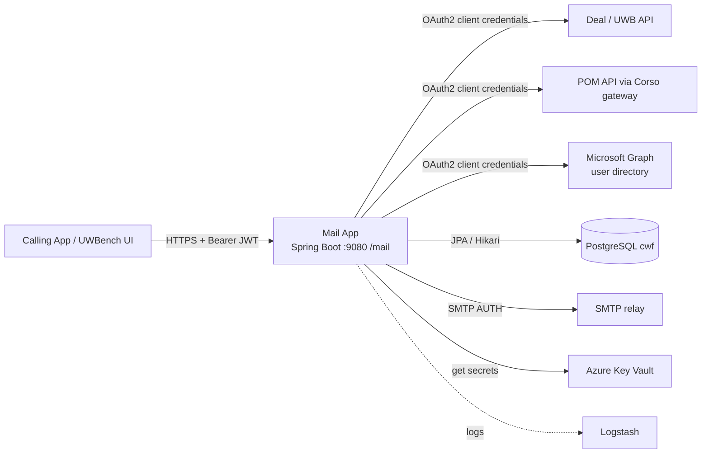

### 1.1 Services Description

#### External services the application depends on

| Service | Role | Protocol / Auth | Used by | Configuration |
|---|---|---|---|---|
| Entra ID (Azure AD) | Issues and validates tokens: validates inbound bearer JWTs (JWKS) and issues client-credentials tokens for outbound calls | OAuth2 / OIDC | `SpringSecurityConfig`, `Oauth2TokenService` | `app.security.jwt.*`, `token-issuer` |
| Deal / UWB API | Returns deal data: insured name, underwriter id and name, UW assistant id, deal name, business area, inception and expiration dates | HTTPS, Bearer token (`uwb-default`) | `DealServiceClient`, `NotificationBO` | `dealUrl` |
| POM API (via Corso gateway) | Returns policy data in `LEGACY` format, including `attributes.brokerName` / `retailBrokerName` | HTTPS, Bearer token (`pom-default`) | `MailHelperBO` | `pomUrl` |
| Microsoft Graph | Fallback user directory: email, given name and surname by SAM account name or display name | HTTPS, Bearer token (`graph-default`) | `GraphUserDirectoryAdapter` | `graphOauth2Scope` |
| PostgreSQL `cwf` | Stores mail templates, notification preferences and users | JDBC (Hikari), username and password | JPA repositories | `DB_CWF_URL`, `cwf-db-*` secrets |
| SMTP relay | Delivers the rendered HTML mail | SMTP AUTH (not OAuth2) | `MailBO` via `JavaMailSender` | `mailTechUser`, `mailTechPass`, `fromAddress` |
| Azure Key Vault | Supplies secrets (DB, SMTP and OAuth2 client credentials) | Managed identity / `DefaultAzureCredential` | Spring Cloud Azure property source | `AZURE_KEYVAULT_ENDPOINT`, `AZURE_KEYVAULT_ENABLED` |
| Logstash | Central log collection | TCP appender | `logback-spring.xml` | `LOGSTASH_URL` |

#### Services exposed by this application

| Endpoint | Service description | Entry class |
|---|---|---|
| `GET /api/health` | Liveness check; returns `Mail Application Working`. Public. | `APIController` |
| `POST /api/initiate/{dealNum}/{policyNum}/{templateName}` | Policy notification mail. Reads deal and policy data, then sends the templated mail to the underwriter (TO) and UW assistant (CC), subject to their notification preferences. | `MailHelperController` |
| `POST /api/initiate/{dealOrPolicyNum}/{templateName}` | Decline notification mail. Reads deal data only and sends the templated mail with the same preference rules. | `MailHelperController` |
| `POST /api/sendEmail` | Generic template dispatch. The caller names the template and assignee; the service builds placeholders from deal data and sends to the assignee, ignoring preferences. | `NotificationController` |
| `/swagger-ui.html`, `/v3/api-docs` | Interactive API documentation. Public. | springdoc |

#### Internal services (Spring components)

| Component | Type | Description |
|---|---|---|
| `RestApplication` | Entry point | Boots Spring Boot, bridges JUL to SLF4J, enables transactions and async, scans `com.rukamini.mail`, and excludes the OAuth2 client auto-configuration because the client is configured manually. |
| `AppConfig` | Configuration | Exposes property values as named beans: the `cwfdataSource` (Hikari), `cwfentityManagerFactory`, `cwfTransactionManager`, `JavaMailSender` (`sender`), `fromAddress`, `pomUrl`, `dealUrl`, `dealAppUrl`, `renewalOverviewUrl`, OAuth2 client id, secret and scopes. |
| `AppProperties` / `SecurityProperties` | Configuration | Typed `@ConfigurationProperties` for `app.*` and `app.security.*`. |
| `SpringSecurityConfig` | Security | Stateless JWT resource server, role mapping, method security and 401/403 handlers. |
| `ResponseCorsFilter` | Filter | Adds CORS response headers for allowed Swissre and localhost origins. |
| `GlobalExceptionHandler` | Advice | Converts exceptions into a consistent `ErrorResponse` JSON payload. |
| `MailHelperBO` | Business service | Orchestrates policy and decline mails: fetches deal and policy data, builds the mail object, delegates to `MailBO`. |
| `NotificationBO` | Business service | Generic template dispatcher for `/sendEmail`; currently supports `UW_AUTHORITY_SELF_DECLARATION`. |
| `MailBO` | Business service | Core mail engine: loads the template, applies preferences, fills placeholders, resolves addresses, builds the `MimeMessage` and sends it. |
| `DealServiceClient` | Integration client | Typed Deal API client; throws `MailException` on non-2xx. Returns `DealAPIModel` (`insuredName`, `underwriterId`, `underwriterName`, `uwAssistantId`; unknown fields ignored). |
| `RestService` | Integration client | Generic OAuth2 Bearer GET client with a map-based and a typed (`Optional<T>`) variant. |
| `HttpClientConfig` | Configuration | Defines the `proxyAwareRestTemplate` (Apache HttpClient 5 `createSystem()`) so JVM proxy settings are honoured. |
| `OAuth2ClientConfig` | Configuration | Declares the `uwb-default`, `pom-default` and `graph-default` client registrations and the authorized client manager. |
| `Oauth2TokenService` | Service | Returns a cached access token for a registration id using the client-credentials grant. |
| `UserDirectoryService` / `GraphUserDirectoryAdapter` | Service | Resolves a user id to `UserDto` (email, first name, last name): cache, then `T_USER`, then Microsoft Graph. |
| `MailUtils` | Utility service | `getUserName(id)` returns `Last,First` for subjects and bodies. |
| `CacheConfig` | Configuration | Caffeine `graphUsers` cache (10 min TTL, 500 entries, stats). |
| `TTemplateRepository`, `NotificationPreferencesRepository`, `TUserRepository` | Data access | Spring Data JPA repositories for `T_TEMPLATE`, `T_NOTIFICATION_PREFERENCES` and `T_USER`. |
| `SpringFoxConfig` | Configuration | OpenAPI metadata for Swagger UI (springdoc auto-discovers endpoints). |

#### How the services collaborate

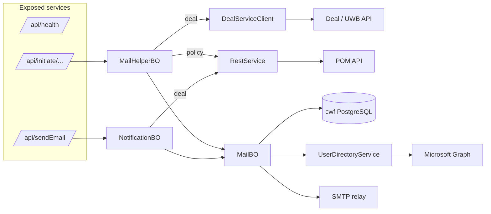

---

## 2. Request Flow

Entry points (all under `/mail/api`):

| Method | Path | Controller | Role check |
|---|---|---|---|
| GET | `/health` | `APIController` | none |
| POST | `/initiate/{dealNum}/{policyNum}/{templateName}` | `MailHelperController` | `@allUserRoles` |
| POST | `/initiate/{dealOrPolicyNum}/{templateName}` | `MailHelperController` | `@allUserRolesWithReadWrite` |
| POST | `/sendEmail` | `NotificationController` | `@allUserRolesWithReadWrite` |

### 2.1 Policy / deal mail (`/initiate/{dealNum}/{policyNum}/{templateName}`)

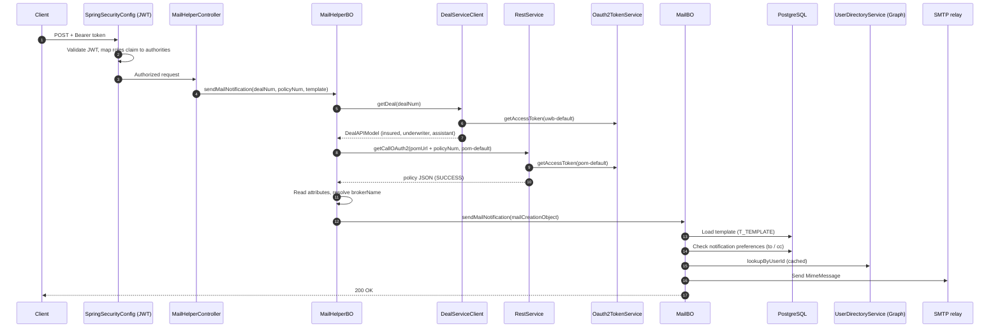

### 2.2 Decline mail (`/initiate/{dealOrPolicyNum}/{templateName}`)

Same as 2.1 without the POM call: `MailHelperBO.sendDeclineDealOrPolicyMailNotification()` fetches the deal from UWB and calls `MailBO.sendMailNotification()` (preference attribute id `10581`; policy creation uses `10580`).

### 2.3 Generic dispatch (`/sendEmail`)

`NotificationController` → `NotificationBO.sendEmail(SendEmailRequest)` → `MailBO.sendTemplateMail()`. The caller supplies recipients, so the `T_NOTIFICATION_PREFERENCES` opt-in check is skipped.

Request body (`SendEmailRequest`, validated with `@Valid`):

| Field | Required | Description |
|---|---|---|
| `dealNumber` | yes (`@NotBlank`) | Deal to fetch from the Deal API |
| `templateName` | yes (`@NotBlank`) | Drives dispatch inside `NotificationBO` (currently `UW_AUTHORITY_SELF_DECLARATION`) |
| `assigneeUserId` | yes (`@NotBlank`) | Single TO recipient (user id resolved to an email) |
| `documentName` | no | Used by templates that reference `${DocumentName}` |

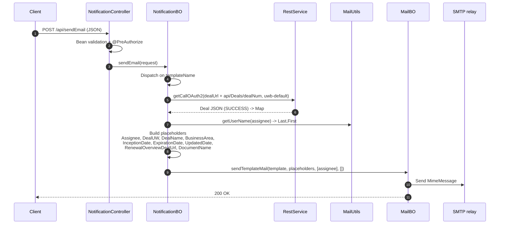

Unsupported or missing `templateName` raises `MailException` ("Unsupported templateName" / "templateName is required"). Deal dates arrive as `yyyyMMdd` and are rendered as `dd MMM yyyy`.

---

## 3. Mail Dispatch Logic (`MailBO`)

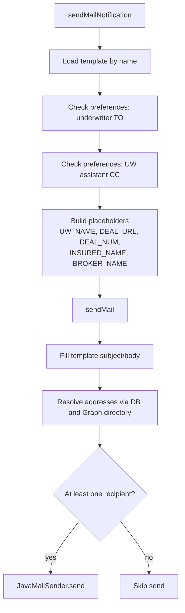

Failures are wrapped in `MailException` and converted to an `ErrorResponse` by `GlobalExceptionHandler`.

Key behaviours:

- **Single-part HTML body:** the message uses `message.setContent(html, contentType)` instead of a `MimeMultipart`, which avoids the `no object DCH for MIME type multipart/mixed` classloader error.
- **Reply-To:** set to the primary recipient's email resolved through `UserDirectoryService`.
- **Subject placeholders:** `${FromValue}` becomes `From :<Last,First>` or `From :CorFlow Admin :` when no user id is available; the `-  -` artefact is collapsed to `-`.
- **Template body/subject:** `${key}` tokens are replaced from the placeholder map (`substituteVariables`).
- **Suppression:** if neither a TO nor a CC address resolves (for example the user opted out), the mail is not sent and `No recipients configured - notification suppressed` is logged.
- **Preference query:** `NotificationPreferencesRepository.fetchUserToSendMails` joins `T_NOTIFICATION_PREFERENCES` with `T_USER`, requires `EMAIL <> 'N'` and `ACTIVE_IND <> 'N'`, and matches the upper-cased user id and attribute id.

---

## 4. Security Flow

```mermaid
flowchart TD
    R[Incoming request] --> P{Profile}
    P -- local --> L[permit-all]
    P -- train / prod --> J[JWT resource server<br/>Entra ID bearer token]
    J --> V[JwtDecoder: issuer + audience validation]
    V --> A[JwtAuthenticationConverter<br/>roles claim -> authorities]
    A --> M[@PreAuthorize hasAnyRole]
    M -- allowed --> OK[Controller]
    M -- denied --> F[403 Forbidden]
```

`app.security.grant-all-roles-to-authenticated=true` grants every role to any authenticated caller.

Security details (`SpringSecurityConfig`):

| Aspect | Behaviour |
|---|---|
| Method security | `@EnableMethodSecurity`; `@PreAuthorize("hasAnyRole(@allUserRoles)")` or `@allUserRolesWithReadWrite` (adds `Read` and `Write`) |
| Role source | `USER_ROLES` list (regional UW/UA roles such as `EMEAPROPUW`, plus `IT_ADMIN`, `READ_ONLY`, and similar), exposed as the beans `allUserRoles` and `allUserRolesWithReadWrite` |
| Token validation | `NimbusJwtDecoder` with a lazy JWKS fetch, issuer check and an audience check against `app.security.jwt.audiences` |
| Authorities | `roles` claim mapped with the `ROLE_` prefix; principal name from the configured user-name claim |
| Public paths (non-local) | `/api/health`, Swagger UI and `/v3/api-docs/**` |
| 401 response | `Authentication failed. Please provide valid credentials.` |
| 403 response | `Access denied. You do not have the required permissions to access this resource.` |
| Session / CSRF | Stateless sessions; CSRF disabled because auth is bearer-token only |
| CORS | `ResponseCorsFilter` echoes the `Origin` header only for `*.swissre.com`, `*.swissreapps(-np).com` and `localhost` |

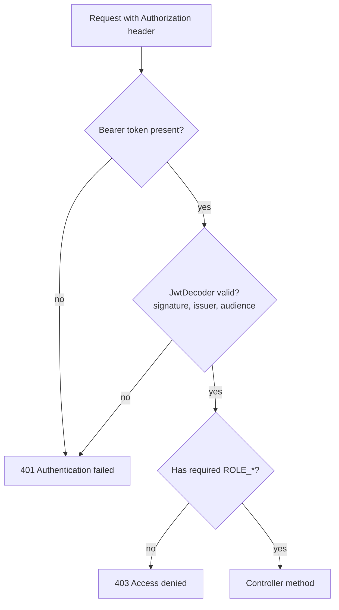

### Outbound OAuth2 (service-to-service)

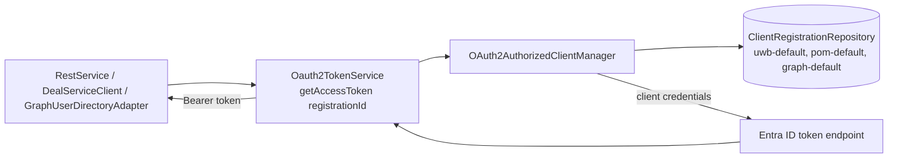

| Registration ID | Target | Scope |
|---|---|---|
| `uwb-default` | UWBench / Deal API | `api://<uwb-app-id>/.default` |
| `pom-default` | Policy Object Manager | `api://pom-train.swissre.com/.default` (NP) / `api://pom.swissre.com/.default` (prod) |
| `graph-default` | Microsoft Graph | `https://graph.microsoft.com/.default` |

All three share the `swisscomOAuthClient` / `swisscomOAuthSecret` credentials but use different audiences, so each has its own independently cached token. `Oauth2TokenService` uses the synthetic principal `service-account`; tokens are cached in memory for their `expires_in` window and refreshed automatically. It throws `IllegalStateException` if the token endpoint returns no token.

---

## 5. Configuration and Startup Flow

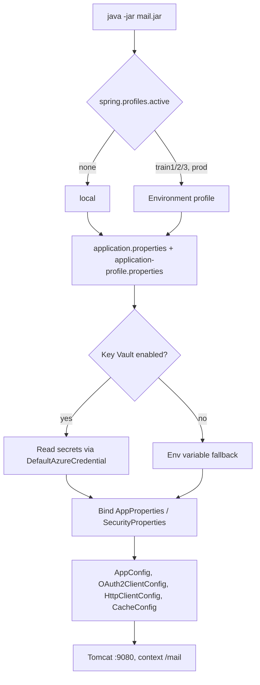

---

## 6. Build, Test and Run

```mermaid
flowchart LR
    V[mvn validate<br/>Spotless format check] --> C[compile]
    C --> T[test<br/>JUnit + JaCoCo]
    T --> P[package<br/>uber jar]
    P --> R[java -jar target/mail-*.jar<br/>--spring.profiles.active=...]
    R --> H[GET /mail/api/health]
    R --> SW[/mail/swagger-ui.html]
```

```powershell
mvn clean verify
java -jar target\mail-0.3.0-SNAPSHOT.jar --spring.profiles.active=local
```

---

## 7. OAuth2 Migration Workflow (Copilot Agents)

Agents live in `.github/agents/`; the status of each outbound call is tracked in [oauth2-migration-registry.md](oauth2-migration-registry.md).

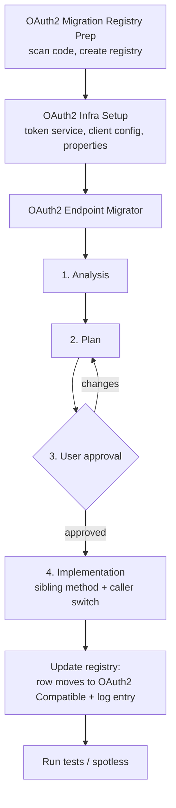

Other agents:

| Agent | Purpose |
|---|---|
| `openliberty-dual-auth` | Inbound dual auth (mpJwt + SPNEGO) with Spring method security |
| `SwissRe Java Upgrade Specialist` | Java / Spring Boot upgrades, `javax` → `jakarta`, CVE fixes |
| `azure-devops` | Pipelines, work items, commits and pull requests |

### Current migration status

| Endpoint | Registration | Status |
|---|---|---|
| POM policies (`pomUrl`) | `pom-default` | OAuth2 |
| UWB deals (`dealUrl`) | `uwb-default` | OAuth2 |
| SMTP relay | n/a | Excluded (SMTP AUTH) |

---

## 8. Layered Component Map

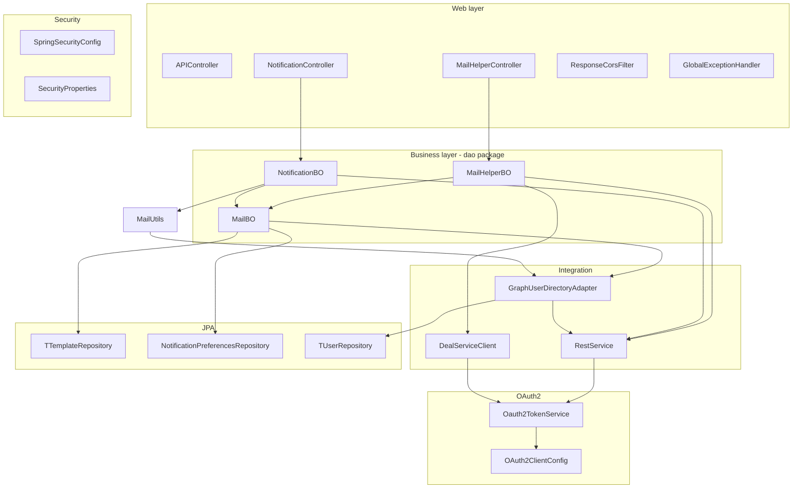

| Package | Responsibility |
|---|---|
| `controller` / `controller.dto` | REST endpoints, request validation, Swagger annotations |
| `dao` | Business objects that orchestrate upstream calls and mail creation (`MailHelperBO`, `NotificationBO`, `MailBO`) |
| `integration` | Outbound REST clients (`RestService`, `DealServiceClient`) and `DealAPIModel` |
| `oauth` | Client registrations and token acquisition |
| `user` | `UserDirectoryService` abstraction, `GraphUserDirectoryAdapter`, `UserDto` |
| `jpa.entity` / `jpa.repository` | `T_TEMPLATE`, `T_NOTIFICATION_PREFERENCES`, `T_USER` access |
| `configuration` | `AppConfig`, `AppProperties`, `SecurityProperties`, `HttpClientConfig`, `CacheConfig`, `SpringFoxConfig`, `RestApplication` |
| `exception` | `MailException`, `ErrorResponse`, `GlobalExceptionHandler` |
| `filter` | `ResponseCorsFilter` |
| `util` | `MailUtils`, `MailConstants` |

---

## 9. User Directory Lookup Flow

`UserDirectoryService.lookupByUserId()` resolves a user id to email, first name and last name. It is used for the Reply-To address, the TO/CC recipients and the user name shown in the subject and body.

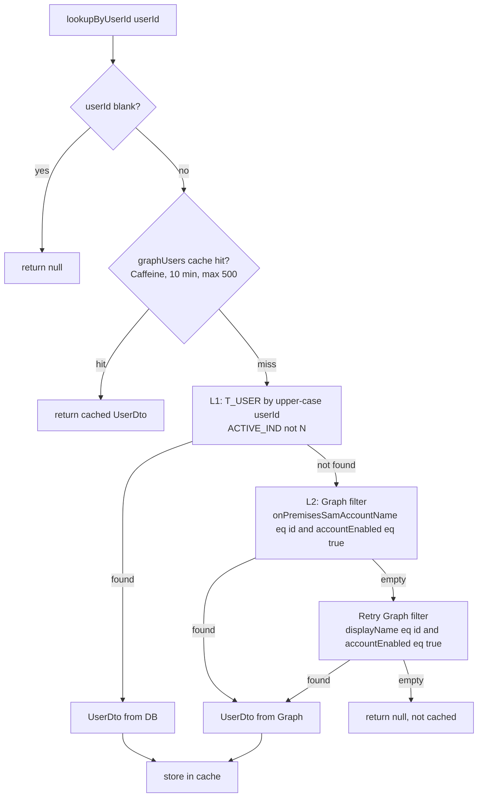

- Graph calls use the `graph-default` registration and the `ConsistencyLevel: eventual` header (required for advanced queries on `onPremisesSamAccountName`).
- Single quotes in the user id are doubled (`''`) per OData 4.0 before the value is URL-encoded, which prevents filter injection.
- `null` results are never cached, so transient Graph failures are retried on the next call.
- `app.user-directory.provider` (`idam` default, `graph`) is documented in `UserDirectoryService`. Only `GraphUserDirectoryAdapter` exists in this repository.

---

## 10. Outbound HTTP Calls

| Client | Used by | Result handling |
|---|---|---|
| `DealServiceClient.getDeal()` | `MailHelperBO` | Typed `DealAPIModel`; non-2xx or transport error throws `MailException` carrying the upstream status |
| `RestService.getCallOAuth2(url, id)` | `MailHelperBO` (POM), `NotificationBO` (Deal) | `Map` with `SUCCESS` (body) or `FAILURE`; callers fail fast when `SUCCESS` is missing |
| `RestService.getCallOAuth2(url, id, Class)` | `GraphUserDirectoryAdapter` | `Optional<T>` via the proxy-aware `RestTemplate`; empty on any error |
| `RestService.getCallOAuth2(url, id, Class, headers)` | Graph advanced queries | Same as above with extra headers |

Common behaviour:

- Connect timeout 30 s, socket timeout 60 s for the Apache HttpClient calls.
- JVM proxy settings (`-Dhttp.proxyHost` and so on) are honoured through `useSystemProperties()` and the `proxyAwareRestTemplate` bean.
- URLs are logged with CR/LF replaced by `_` to prevent log injection.
- Every call logs `Outbound auth applied=OAUTH2_BEARER registration=...`.

---

## 11. Error Handling Flow

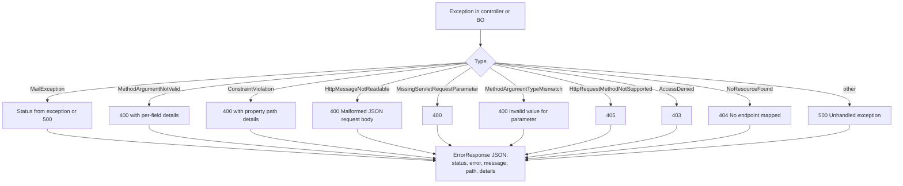

Business layers rethrow `MailException` with context and do not log; `GlobalExceptionHandler` is the single place where errors are logged.

---

## 12. Data Access

| Table | Entity / Repository | Purpose |
|---|---|---|
| `T_TEMPLATE` | `TTemplate` / `TTemplateRepository.getMailTemplate(name)` | Mail subject and body templates with `${placeholder}` tokens |
| `T_NOTIFICATION_PREFERENCES` | `TNotificationPreferences` / `NotificationPreferencesRepository` | Per-user, per-attribute email opt-in |
| `T_USER` | `TUser` / `TUserRepository.findActiveByUserId` | L1 user lookup for email and name |

Notification attribute ids: `10580` = policy creation mail, `10581` = deal decline mail.

Connection: PostgreSQL `cwf` datasource through Hikari; credentials come from Key Vault (`cwf-db-username`, `cwf-db-password`) or `DB_CWF_USER` / `DB_CWF_PASSWORD`.

---

## 13. Environment Matrix

| Concern | `local` | `train1` / `train2` / `train3` | `prod` |
|---|---|---|---|
| Inbound security | permit-all | JWT + role checks | JWT + role checks |
| Azure Key Vault | off | on | on |
| Secrets source | env variables | Key Vault, env fallback | Key Vault, env fallback |
| Database | localhost defaults | `DB_CWF_URL` (required) | `DB_CWF_URL` (required) |
| Downstream URLs | localhost / stubs | NP endpoints per train | production endpoints |
| Logging | console only | console + Logstash (`LOGSTASH_URL`) | console + Logstash |
| Outbound auth | OAuth2 | OAuth2 | OAuth2 |

---

## 14. Observability and API Docs

- **Health:** `GET /mail/api/health` returns `Mail Application Working` and is public.
- **Swagger UI:** `/mail/swagger-ui.html` and `/mail/v3/api-docs` (springdoc scans `com.rukamini.mail.controller`).
- **Logging:** `logback-spring.xml`; Logstash TCP appender in every profile except `local`.
- **Cache stats:** the `graphUsers` Caffeine cache records stats.
- **Log hygiene:** user ids and recipient values are not logged (Sonar S5145); outbound URLs are CR/LF sanitised.

---

## 15. Test Map

| Area | Test classes |
|---|---|
| Controllers / DTO | `NotificationControllerTest`, `SendEmailRequestTest` |
| Business objects | `MailBOTest`, `MailHelperBOTest`, `NotificationBOTest` |
| Integration clients | `RestServiceTest` |
| OAuth2 | `OAuth2ClientConfigTest`, `Oauth2TokenServiceTest`, `Oauth2TokenServiceIT` |
| User directory | `GraphUserDirectoryAdapterTest`, `GraphUserDirectoryAdapterCacheTest` |
| Security | `SpringSecurityConfigTest` (local and prod profiles), `SpringSecurityConfigUnitTest` |
| Errors | `GlobalExceptionHandlerTest`, `ErrorResponseTest` |
| Configuration / utils | `AppConfigTest`, `AppPropertiesBindingTest`, `RestApplicationTest`, `MailUtilsTest` |

Surefire reports are written to `target/surefire-reports`; JaCoCo coverage to `target/site/jacoco`.

---

## 16. Extension Guides

### 16.1 Add a new mail template to `/sendEmail`

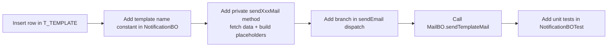

### 16.2 Add a new outbound OAuth2 service

1. Declare a registration id constant in `OAuth2ClientConfig`.
2. Add a `ClientRegistration` bean (credentials and scope beans in `AppConfig`, token URI from `token-issuer`).
3. Call `restService.getCallOAuth2(url, <REGISTRATION_ID>)` or the typed overload.
4. Record the endpoint in [oauth2-migration-registry.md](oauth2-migration-registry.md).
5. Add the scope property to each `application-*.properties` file.

### 16.3 Add a new REST endpoint

1. Add a method to a controller under `/api` with `@PreAuthorize` and Swagger annotations.
2. Use `@NotBlank` / `@Valid` for input validation; errors are handled by `GlobalExceptionHandler`.
3. Put the orchestration in a `dao` business object; throw `MailException` on failure.
4. Add controller and business-object tests, then run `mvn clean verify` (Spotless runs on `validate`).

---

## 17. Troubleshooting

| Symptom | Likely cause | Check |
|---|---|---|
| 401 `Authentication failed` | Missing, expired or wrong-audience token | Issuer and `app.security.jwt.audiences`; token `aud` claim |
| 403 `Access denied` | Token lacks a required role | `roles` claim; `grant-all-roles-to-authenticated` for testing |
| `Policy data retrieval failed for policyNum=...` | POM call returned `FAILURE` | `pomUrl`, `pom-default` scope, proxy settings, POM availability |
| `Deal data retrieval failed ... status=NNN` | Deal API returned non-2xx | `dealUrl`, `uwb-default` scope, deal number |
| `token endpoint returned no access token` | Wrong client id, secret, scope or token URI | Key Vault secrets, `token-issuer`, scope properties |
| Mail not delivered, no error | Recipient opted out or has no active email | `T_NOTIFICATION_PREFERENCES`, `T_USER.ACTIVE_IND`, log line `No recipients configured` |
| `Mail template not found` / empty body | Template name missing from `T_TEMPLATE` | `T_TEMPLATE.TEMPLATE_NAME` |
| Startup failure on `train*` / `prod` | Missing `DB_CWF_URL` or Key Vault access | Env variables, managed identity `get` and `list` permission |
| Graph lookup returns nothing | User disabled, or missing `User.Read.All` application permission | Graph filter logs at DEBUG; Entra app permissions |

---

## 18. Glossary

| Term | Meaning |
|---|---|
| UWB / UWBench | Underwriting workbench; source of deal data |
| POM | Policy Object Manager; source of policy data |
| CWF / CorFlow | Workflow database and application that owns `T_*` tables |
| Corso | API gateway fronting POM |
| UW / UA | Underwriter / Underwriting Assistant |
| Entra ID | Identity provider issuing inbound and outbound tokens |
| Sibling-method pattern | Adding an OAuth2 method next to the legacy one instead of modifying it |
