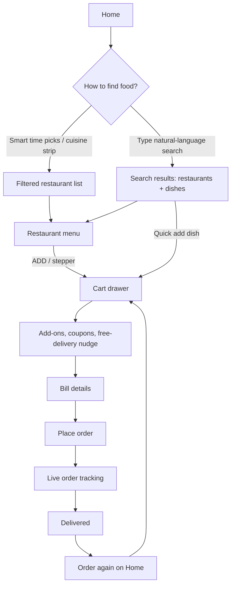

# Rukamini Restaurant - Smart Restaurant Prototype

A standalone, front-end-only food ordering prototype inspired by the Swiggy and Zomato experience. It runs entirely in the browser with mock data. No backend, build step or dependencies are needed.

## Run

### Provider connection status

The expandable notice identifies all displayed restaurants and orders as demo
data. Zomato and Swiggy are **not connected**. Server-side configuration slots and
an authenticated readiness endpoint are prepared in the
[backend](../rukmini-eat-app/README.md#zomato--swiggy-integration-preparation).
The prototype does not fetch live provider data, accept provider keys, or send
real orders. Approved access and verified API contracts are required to implement
the adapters; environment variables alone do not enable them.

Open `index.html` in a browser, or serve the folder:

```
npx serve .
```

## Files

| File | Purpose |
|---|---|
| `index.html` | Page shell: header, search, cart drawer, tracking modal. |
| `styles.css` | Responsive styling. |
| `app.js` | State, smart logic, rendering and the original 26 restaurants (mock data). |
| `catalog.js` | 100 additional restaurants with 100 new cuisines and 500 dishes (mock data). Loaded before `app.js`. |
| `README.md` | This document. |

## User Flow



## Feature Highlights

### Discovery (Swiggy / Zomato style)
- 126 restaurants (ids `r1`-`r126`) with distinct menus. The original 26 include Thai, Gujarati, Maharashtrian, street food, Rajasthani, ice cream, Andhra and Italian specialists; `catalog.js` adds 100 more, each with its own cuisine (Korean, Lebanese, Kerala, Hyderabadi, Sushi, Tacos, Bubble Tea, Mithai, Vegan and more), 5 dishes each. The cuisine strip lists all 123 cuisines and scrolls sideways.
- Working Explore, Reset filters and offer cards; selecting an offer keeps its code ready as you build your cart.
- Responsive discovery cards and demo sign-in, with visible keyboard focus and reduced-motion support.
- Cuisine strip ("What's on your mind?") and restaurant cards with rating, ETA, cost for two, offer ribbon and pure-veg tag.
- Filters: pure veg, rating 4.3+, under 25 mins, offers. Sort by smart relevance, rating, delivery time or cost.
- Restaurant page with category-grouped menu, veg/non-veg markers, bestseller tags and a veg-only toggle.

### Smart features
| Feature | How it works |
|---|---|
| Time-aware home | Picks a meal slot (breakfast, lunch, snacks, dinner, late night) from the clock and suggests matching cuisines. A dropdown lets you simulate any slot. |
| Smart relevance ranking | Score = rating, faster delivery, offers, meal-slot match and "ordered before" boost. |
| Natural-language search | Understands phrases like `veg pizza under 300`, `fast biryani`, `top rated desserts`, `non veg burger below 200`. The "Understood as" chips show the parsed intent. |
| Typo-tolerant search | Prefix matching, small synonym map and Levenshtein distance (`pizzza`, `biriyani`, `cafe` for `Café`). |
| Autocomplete | Suggests restaurants, cuisines and dishes while typing. |
| Add-on suggestions | In the cart, offers a side, bread, drink or dessert from the same restaurant that is not yet in the cart. |
| Free-delivery nudge | Progress bar showing how much more to add for free delivery, plus the next coupon to unlock. |
| Auto-best coupon | Applies the coupon with the highest saving. The user can remove it or enter a code. |
| Order again | Past orders are stored locally and can be reordered or tracked from Home. |

## Demo Login

Use **Log in**, then **Fill demo details**, or enter `demo@rukmini.com` / `Demo@123`. Show/Hide toggles password visibility. Checkout asks guests to demo-sign in, then returns to the cart for confirmation. This is not real authentication; no password is stored and no real payment is taken. You can browse and build a cart without signing in.

## Validation

Run the dependency-free regression checks with `node --test app.test.cjs` from this folder.

## Design and Responsive Layout

- Warm ivory surfaces, burnt-orange calls to action and deep-green accents give the prototype a neighbourhood food-brand identity. System sans-serif typography pairs with local serif headings; no external fonts, images or packages are loaded.
- The hero combines existing emoji artwork with a plate, orbit and fresh-food sticker. Restaurant illustrations, offer tickets and scrollable cuisine choices use the same visual language.
- Phone layouts use single-column restaurant cards and stacked offers; tablets use two restaurant columns and a horizontally scrollable offer rail. Desktop layouts use three restaurant columns at 1024px and four at 1280px, alongside three offer tickets. Search remains on its own header row until desktop.
- Layouts are designed for 320px, 375px, 768px, 1024px and 1440px viewports. Long menu names wrap without pushing quantity controls or prices offscreen; cuisine and add-on rails scroll locally rather than widening the page.
- Keyboard users get a **Skip to main content** link and visible focus rings. Controls have at least 44px touch height, and reduced-motion preferences disable decorative transitions and smooth scrolling.
- The closed cart drawer is removed from layout and visibility. Open cart and tracking surfaces use dynamic viewport sizing, independent scrolling and device safe-area spacing; the floating cart summary remains reachable on phones.

## Pricing Rules

| Item | Rule |
|---|---|
| Delivery fee | ₹40, free for item total ≥ ₹399 |
| GST | 5% on (item total − discount) |
| Platform fee | ₹5 |
| `WELCOME50` | 50% off up to ₹100, min ₹199 |
| `SAVE20` | 20% off up to ₹80, min ₹149 |
| `BIGFEAST` | Flat ₹150 off, min ₹699 |

The cart holds items from one restaurant at a time. Adding from another restaurant asks for confirmation before replacing the cart.

## Order Tracking

After placing an order, a modal shows four stages: Order placed, Preparing, Out for delivery (with rider name), Delivered. For demo purposes each stage lasts 6 seconds, and the ETA counts down proportionally. Tracking state is derived from the order timestamp, so it survives a page reload.

## Data Model (mock, in `app.js` and `catalog.js`)

```
Restaurant { id, name, cuisines[], rating, votes, eta, costForTwo, pureVeg, offers, emoji, menu[] }
Dish       { id, name, price, veg, emoji, cat, best }
Cart       { restId, items: { dishId: qty } }
Order      { id, restId, restName, items[], total, saved, placedAt, eta, rider }
```

Cart and order history persist in `localStorage` (`fl_cart`, `fl_orders`).

`catalog.js` stores each new restaurant as a compact row (`[name, cuisines, rating, votes, eta, costForTwo, emoji, offers, dishes]`, each dish `[name, price, veg, emoji, category]`) and expands it into the model above. A restaurant is marked pure veg only when every dish is vegetarian. To add more, append rows to `EXTRA_ROWS`; ids, the cuisine strip entry and the bestseller flag are generated. Keep the first cuisine of a row unique.

## Limitations and Next Steps

- Mock data only; no real payments, addresses, maps or authentication.
- Possible extensions: address book, live map tracking, ratings and reviews, scheduled orders, a backend API with a database, and personalized recommendations from real order history.
